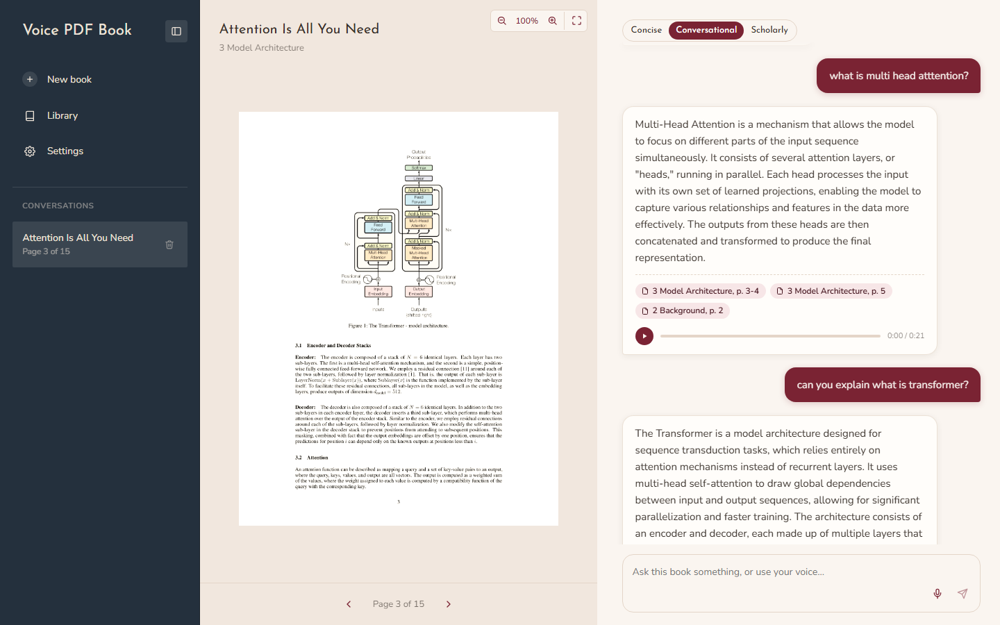
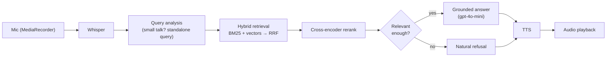
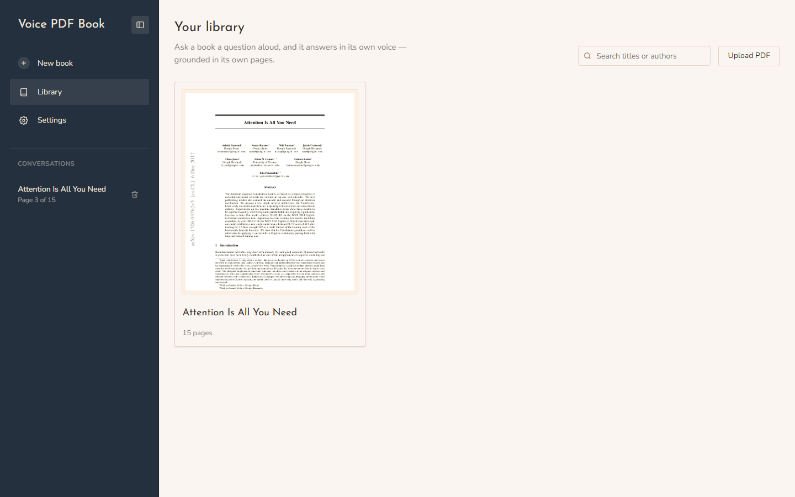
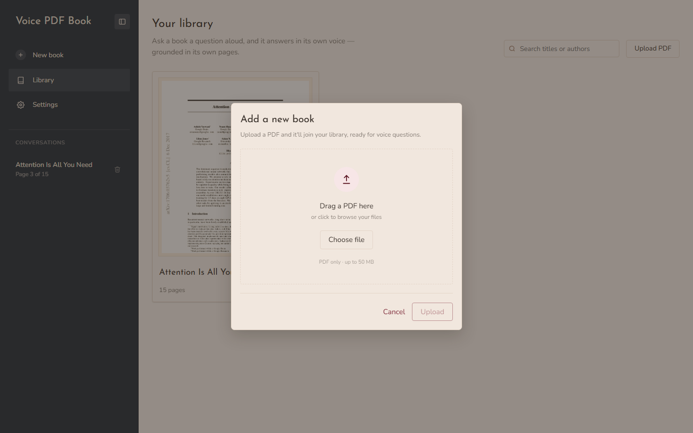
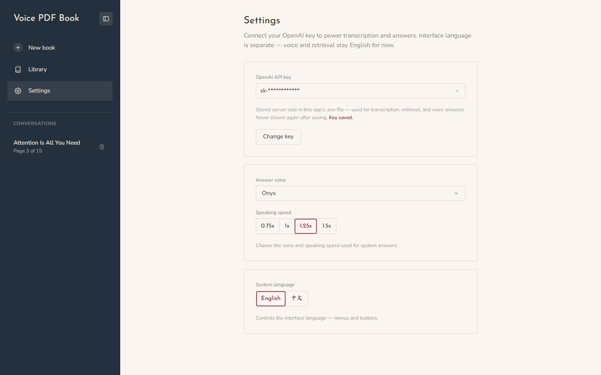

# Voice PDF Book

Upload a PDF book and talk to it. Ask a question by voice (or type it) and get a spoken answer
grounded in the book's own pages, with citations you can click to jump to the source.





## Features

- **Library of books.** Upload several PDFs; each book has its own conversation, reading
  position and answer tone. Ingestion runs in the background, so the UI stays responsive.
- **Voice in, voice out.** Record a question, get a transcription, an answer and a spoken
  reply. Both your recording and the spoken answer are saved, so past turns stay replayable
  and scrubbable.
- **Structure-aware retrieval.** Chunks follow chapter and section boundaries (from the PDF's
  table of contents when it has one, heading heuristics when it doesn't), with overlap between
  neighbours. Search is hybrid: BM25 keyword search and vector similarity run side by side,
  are merged with Reciprocal Rank Fusion, and are re-scored by a cross-encoder reranker.
- **Honest refusals.** If nothing retrieved is relevant enough (a hard threshold on the
  reranker score, not an LLM judgement call), the app says the book doesn't cover it instead
  of answering from general knowledge.
- **Conversation memory.** A window of the most recent messages plus a rolling summary of
  older ones, so follow-ups like "why not?" resolve correctly, even right after a refusal.
- **Citations.** Every answer lists the chapters and pages it drew on; click one to jump the
  PDF viewer to that page.
- **Answer tone.** Switch between Concise, Conversational and Scholarly per conversation, from the pills at the top of the chat.
- **Configurable at runtime.** The OpenAI key, voice and speaking speed are set from the
  Settings page and take effect immediately, with no restart and no hand-editing of `.env`.

## Screenshots

### Library

Each book is a card with its first page as the cover.



### Upload



### Settings



## Tech stack

| Layer | Choice |
|---|---|
| Frontend | React 19 + TypeScript, Next.js (App Router) |
| Backend | FastAPI (Python) |
| Metadata and sessions | SQLite (SQLAlchemy) |
| PDF parsing | PyMuPDF |
| Embeddings | OpenAI `text-embedding-3-small` |
| Vector store | ChromaDB |
| Keyword search | BM25 (`rank-bm25`) |
| Hybrid merge | Reciprocal Rank Fusion |
| Reranker | Cross-encoder `ms-marco-MiniLM-L-6-v2` (`sentence-transformers`, runs locally) |
| LLM | OpenAI `gpt-4o-mini` |
| Speech to text | OpenAI Whisper (`whisper-1`) |
| Text to speech | OpenAI `gpt-4o-mini-tts` |
| Audio capture | Browser `MediaRecorder` API |

## Getting started

### Prerequisites

- **Python 3.11+**
- **Node.js 20+** and npm
- **An OpenAI API key** ([create one](https://platform.openai.com/api-keys)), used for
  embeddings, chat, Whisper and text-to-speech. You enter it in the app's **Settings** page
  after it starts, so you don't need it up front.

### Option 1: launcher script (recommended)

From the project root:

| Platform | Run |
|---|---|
| macOS | Double-click **`scripts/Start Demo.command`** (the first time, click **Open** when Finder asks) |
| macOS / Linux | `./scripts/start.sh` |
| Windows | Double-click **`scripts\start.bat`**, or run it from a Command Prompt |

The script checks for Python and npm, creates `backend/venv` and installs dependencies (the
first run downloads a few hundred MB of ML libraries and the reranker model, so allow a few
minutes), creates `backend/.env` from the template, runs `npm install`, starts both servers,
waits for the backend and opens the app. It frees ports 8000 and 3000 first, so it's safe to
re-run.

- **macOS / Linux:** both servers share one terminal; press **Ctrl+C** to stop them. Logs go to
  `logs/backend.log` and `logs/frontend.log`.
- **Windows:** the backend and frontend each open in their own window; close both to stop.

### Option 2: manual setup

**Backend** (from the project root):

```bash
cd backend
python3 -m venv venv
source venv/bin/activate          # Windows: venv\Scripts\activate
pip install -r requirements.txt
cp .env.example .env              # Windows: copy .env.example .env
uvicorn app.main:app --reload --port 8000
```

> **Slow `pip install`?** The backend pulls in torch and sentence-transformers for the local
> reranker. [`uv`](https://docs.astral.sh/uv/) is a much faster drop-in: `pip install uv`, then
> `uv venv venv` and `uv pip install -r requirements.txt`.

**Frontend** (in a second terminal):

```bash
cd frontend
npm install
npm run dev
```

Open http://localhost:3000. The frontend proxies API calls to the backend on port 8000 (see
`frontend/next.config.ts`), so keep the backend on that port.

### First run

1. Open **Settings**, paste your OpenAI key and click **Save key**. Until a key is saved,
   uploading and asking show a prompt to add one rather than failing silently.
2. Go to **Library**, click **Upload PDF** and pick a book (PDF only, up to 50 MB).
   A sample paper is included at `backend/tests/fixtures/attention_is_all_you_need.pdf`.
3. When the book's status shows **ready**, open it and ask a question with the mic button
   or the text box. Browsers allow microphone access on `localhost`.

## Configuration

Everything below is editable from **Settings** and persisted to `backend/.env`; you only edit
the file by hand if you prefer to.

| Variable | Default | Description |
|---|---|---|
| `OPENAI_API_KEY` | _(empty)_ | Format-checked (`sk-…`), stored server-side and never sent back to the browser once saved |
| `TTS_VOICE` | `alloy` | One of `alloy`, `ash`, `ballad`, `coral`, `echo`, `fable`, `nova`, `onyx`, `sage`, `shimmer`, `verse` |
| `TTS_SPEED` | `1.25` | Speaking speed, 0.5 to 2.0 |

The interface language toggle (English / 中文) only translates menus and buttons. Speech
recognition, speech synthesis and retrieval are English-only.

## How it works

**Ingestion.** An upload returns immediately with status `processing`; a background task
parses the PDF (PyMuPDF), splits it into chapter-aware overlapping chunks, embeds them, and
writes them to both ChromaDB (vectors) and SQLite (the BM25 corpus), keyed by the same chunk
id so the two ranked lists can be merged. The status becomes `ready`, or `failed` with an
error message.

**Answering.** For each question the backend:

1. Transcribes audio with Whisper (voice turns only).
2. Runs one memory-aware LLM call that classifies the message (small talk or a real
   question) and, for real questions, rewrites it as a standalone search query. Small talk
   skips retrieval.
3. Runs BM25 and vector search over that book's chunks, merges them with RRF, and reranks the
   merged list with the cross-encoder to pick the top few chunks.
4. If the top rerank score is below the threshold (`REFUSAL_THRESHOLD` in
   `backend/app/core/rag.py`), writes a natural refusal. Otherwise generates an answer from
   the retrieved chunks, the conversation memory and the chosen tone.
5. Synthesizes speech, saves the audio, and stores the turn with its citations.

**Memory** has two layers: the last 8 messages verbatim, and a rolling summary that older
messages are folded into by a background task, so it never blocks a reply.

## API

Interactive docs are served by FastAPI at http://localhost:8000/docs.

| Endpoint | Purpose |
|---|---|
| `POST /documents/upload` | Upload a PDF (5 requests/min) |
| `GET /documents` | List books |
| `GET /documents/{id}` | Ingestion status |
| `DELETE /documents/{id}` | Delete a book and its data |
| `GET /documents/{id}/chapters` | Chapter list |
| `GET /documents/{id}/pages/{n}` | Rendered page image |
| `GET /documents/{id}/conversation` | Get or create the book's conversation |
| `PATCH /conversations/{id}` | Update answer tone or reading position |
| `DELETE /conversations/{id}` | Delete a conversation |
| `GET /conversations/{id}/messages` | Message history with citations |
| `POST /chat` | Text question → answer and citations (20/min) |
| `POST /ask` | Voice question (audio upload) → transcript, answer, citations and spoken audio (20/min) |
| `POST /transcribe` | Audio → text |
| `GET/PUT/DELETE /settings…` | Read settings, save or clear the API key, set voice and speed |
| `GET /audio/{file}` | Saved answer and question audio |

## Project structure

```
.
├── backend/
│   ├── app/
│   │   ├── main.py            # FastAPI entrypoint
│   │   ├── config.py          # settings, .env read/write
│   │   ├── api/routes/        # documents, chat, settings
│   │   ├── core/              # pdf_parser, chunker, embeddings, vector_store,
│   │   │                      # keyword_search, retrieval (RRF), reranker, rag,
│   │   │                      # memory, asr, tts
│   │   ├── db/                # SQLAlchemy models and session
│   │   └── schemas/           # Pydantic models
│   ├── tests/                 # pytest suite and fixture PDFs
│   ├── scripts/               # retrieval eval, QA benchmark, helper scripts
│   ├── eval/                  # retrieval eval queries and results
│   └── data/                  # SQLite db, Chroma store, PDFs, audio (gitignored)
├── frontend/
│   ├── next.config.ts         # proxies backend paths to :8000
│   └── src/
│       ├── app/               # routes: /library, /books/[id], /preferences
│       ├── components/        # AppShell, Sidebar, Library, ChatArea, …
│       ├── api/client.ts      # fetch wrappers for the backend
│       └── i18n.ts            # UI strings (English / 中文)
├── docs/screenshots/
├── scripts/               # launchers: start.sh, start.bat, Start Demo.command
└── CLAUDE.md                  # design decisions and working notes
```

## Testing and evaluation

All checks need the backend venv active and a real key in `backend/.env`, because they make
real OpenAI calls (nothing is mocked).

**Test suite.** Covers upload and ingestion, chat, voice, settings (including key gating and
rate limits) and the RAG pipeline. It runs against an isolated temporary database, vector store
and `.env`, so it never touches your data.

```bash
cd backend
source venv/bin/activate          # Windows: venv\Scripts\activate
pytest -q                         # a few minutes; add a path to run one file
```

**Retrieval eval and QA benchmark.** Both are written against the sample paper, so upload
`backend/tests/fixtures/attention_is_all_you_need.pdf` through the app first. They match the
book by title; pass `--document-id <id>` if that fails.

```bash
python scripts/eval_retrieval.py [--document-id ID] [--out eval/results.json]
python scripts/run_qa_benchmark.py [--document-id ID]
```

- `eval_retrieval.py` runs `eval/queries.json` through vector-only search and the full hybrid
  pipeline, judges both with an LLM, and reports a hit-rate comparison.
- `run_qa_benchmark.py` asks fixed questions through `/chat` and checks each answer for the
  facts it must contain (for example the paper's 28.4 BLEU score). One case is out of scope
  on purpose and must trigger a refusal. It exits non-zero if any case fails.

## Troubleshooting

- **Port already in use.** Something is bound to 8000 or 3000. The launcher frees them
  automatically; when running manually, stop the other process or choose different ports
  (and update `next.config.ts` if you move the backend).
- **First backend start is slow.** The reranker model downloads from Hugging Face once, then
  is cached.
- **"Set up your OpenAI API key in Settings first."** Expected until a key is saved.
- **Uploads or answers fail with an OpenAI error.** Check the key and its quota on the
  Settings page; saving again retries without a restart.
- **Large uploads hang or fail.** The backend accepts PDFs up to 50 MB, and the frontend proxy
  is configured to match; larger files are rejected.

## Limitations

- English only for speech recognition, synthesis and retrieval.
- Answers are generated in full, then synthesized in full; sentence-level streaming to TTS
  isn't implemented yet, so there is a short wait before audio starts.
- The reading position is display-only; retrieval always searches the whole book.
- No authentication. The app is meant to run locally for one user.
